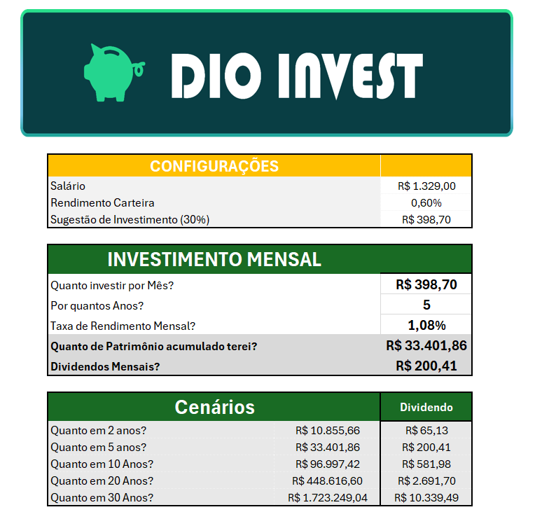
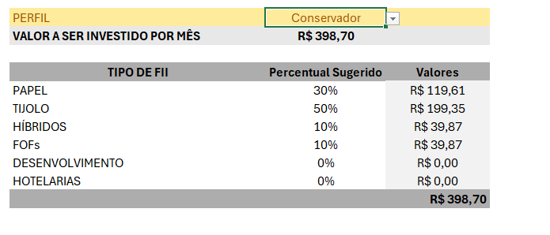
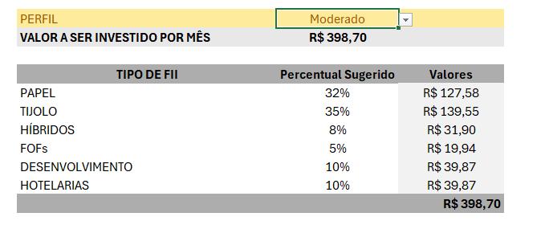
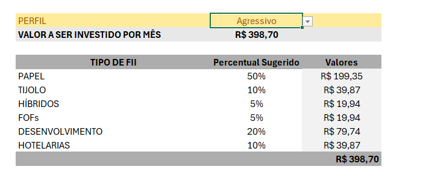

# simulador-fiis
# 📊 Simulador de Investimentos em FIIs

## 📌 Sobre o projeto

Projeto desenvolvido como atividade prática durante o curso da [DIO](https://www.dio.me/), com orientação do Expert Felipe Aguiar.

O objetivo é construir uma ferramenta no Microsoft Excel para simular investimentos em Fundos de Investimento Imobiliário (FIIs), permitindo visualizar a evolução do patrimônio, estimar dividendos mensais e distribuir aportes de acordo com diferentes perfis de investidor.

## 🎯 Funcionalidades

- Definição do aporte mensal.
- Configuração do prazo de investimento em anos.
- Definição da taxa de rendimento mensal.
- Cálculo do patrimônio acumulado.
- Estimativa de dividendos mensais.
- Projeção do patrimônio em cenários de 2, 5, 10, 20 e 30 anos.
- Sugestão de aporte equivalente a 30% do salário.
- Distribuição dos aportes entre seis tipos de fundos imobiliários.
- Seleção de perfil de investidor: Conservador, Moderado e Agressivo.
- Consulta automática dos percentuais de alocação conforme o perfil escolhido.

## 🛠️ Tecnologias e recursos utilizados

- Microsoft Excel
- Função VF (Valor Futuro)
- Função PROCV
- Validação de dados
- Intervalos nomeados
- Referências absolutas e relativas
- Tabelas auxiliares
- Chaves compostas para consulta de dados
- Formatação de células e organização de interface

## 📷 Demonstração

### Tela principal

A tela principal reúne as configurações, os dados do investimento mensal, o patrimônio acumulado, os dividendos estimados e as projeções para diferentes períodos.

### Perfil Conservador

Distribuição dos aportes com maior participação em fundos de tijolo e menor exposição às demais categorias, conforme os percentuais definidos na tabela de apoio.

### Perfil Moderado

Distribuição diversificada entre as seis categorias de fundos imobiliários.

### Perfil Agressivo

Distribuição com maior participação na categoria de papel, conforme os parâmetros definidos para o perfil.

### Tabela de apoio

Tabela auxiliar utilizada para relacionar cada perfil aos tipos de fundos e
