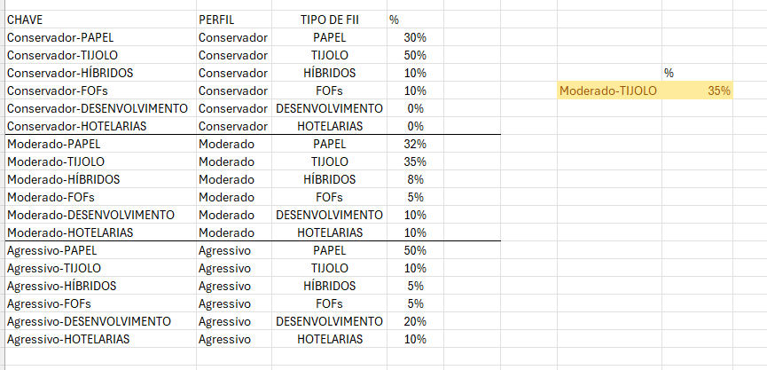

# simulador-fiis
# 📊 Simulador de Investimentos em FIIs

## 📌 Sobre o projeto

Projeto desenvolvido como atividade prática durante o curso da [DIO](https://www.dio.me/), com orientação do Expert Felipe Aguiar.

O objetivo é construir uma ferramenta no Microsoft Excel para simular investimentos em Fundos de Investimento Imobiliário (FIIs), permitindo visualizar a evolução do patrimônio, estimar dividendos mensais e distribuir aportes de acordo com diferentes perfis de investidor.

## 🎯 Funcionalidades

- Definição do aporte mensal.
- Configuração do prazo de investimento em anos.
- Definição da taxa de rendimento mensal.
- Cálculo do patrimônio acumulado.
- Estimativa de dividendos mensais.
- Projeção do patrimônio em cenários de 2, 5, 10, 20 e 30 anos.
- Sugestão de aporte equivalente a 30% do salário.
- Distribuição dos aportes entre seis tipos de fundos imobiliários.
- Seleção de perfil de investidor: Conservador, Moderado e Agressivo.
- Consulta automática dos percentuais de alocação conforme o perfil escolhido.

## 🛠️ Tecnologias e recursos utilizados

- Microsoft Excel
- Função VF (Valor Futuro)
- Função PROCV
- Validação de dados
- Intervalos nomeados
- Referências absolutas e relativas
- Tabelas auxiliares
- Chaves compostas para consulta de dados
- Formatação de células e organização de interface

## 📷 Demonstração

### Tela principal

A tela principal reúne as configurações, os dados do investimento mensal, o patrimônio acumulado, os dividendos estimados e as projeções para diferentes períodos.

### Perfil Conservador

Distribuição dos aportes com maior participação em fundos de tijolo e menor exposição às demais categorias, conforme os percentuais definidos na tabela de apoio.

### Perfil Moderado

Distribuição diversificada entre as seis categorias de fundos imobiliários.

### Perfil Agressivo

Distribuição com maior participação na categoria de papel, conforme os parâmetros definidos para o perfil.

### Tabela de apoio

Tabela auxiliar utilizada para relacionar cada perfil aos tipos de fundos e aos respectivos percentuais de alocação.

## 🧮 Como funciona

### Cálculo do patrimônio

A função `VF` é utilizada para calcular o valor futuro dos investimentos com base na taxa de rendimento mensal, no número de períodos e nos aportes realizados.

Esse cálculo permite estimar o patrimônio acumulado ao final do prazo selecionado.

### Cálculo dos dividendos

A estimativa de dividendos mensais é calculada a partir do patrimônio projetado e da taxa de distribuição mensal utilizada na simulação.

### Distribuição por perfil

A função `PROCV` consulta uma tabela auxiliar que contém os perfis, os tipos de fundos e os percentuais correspondentes.

Uma chave composta, formada pela combinação do perfil e do tipo de fundo, permite localizar o percentual correto para cada categoria.

A validação de dados permite selecionar o perfil desejado em uma lista suspensa, atualizando a distribuição dos aportes.

### Intervalos nomeados

Intervalos nomeados são utilizados para facilitar a leitura e a manutenção das fórmulas, substituindo referências diretas a células por nomes mais descritivos.

Entre os exemplos previstos na atividade estão `aporte` e `taxa_mensal`.

## 📈 Perfis de investimento

Os percentuais utilizados na simulação são parâmetros ilustrativos para demonstrar a distribuição dos aportes.

| Tipo de FII | Conservador | Moderado | Agressivo |
|---|---:|---:|---:|
| Papel | 30% | 32% | 50% |
| Tijolo | 50% | 35% | 10% |
| Híbridos | 10% | 8% | 5% |
| FOFs | 10% | 5% | 5% |
| Desenvolvimento | 0% | 10% | 20% |
| Hotelarias | 0% | 10% | 10% |
| **Total** | **100%** | **100%** | **100%** |

## 🚀 Como utilizar

1. Baixe o arquivo Excel disponibilizado neste repositório.
2. Abra a planilha no Microsoft Excel.
3. Informe os parâmetros do investimento.
4. Consulte o patrimônio acumulado e os dividendos estimados.
5. Analise os diferentes cenários de prazo.
6. Selecione outro perfil de investidor para visualizar a distribuição dos aportes.

## 📚 Aprendizados

O desenvolvimento desta atividade permitiu praticar conceitos de Excel aplicados a um problema financeiro, incluindo fórmulas de valor futuro, consultas em tabelas, validação de dados, intervalos nomeados e projeções de investimentos.

Também foi possível compreender como organizar uma ferramenta para que o usuário consiga alterar parâmetros e visualizar resultados sem precisar editar diretamente as fórmulas.

